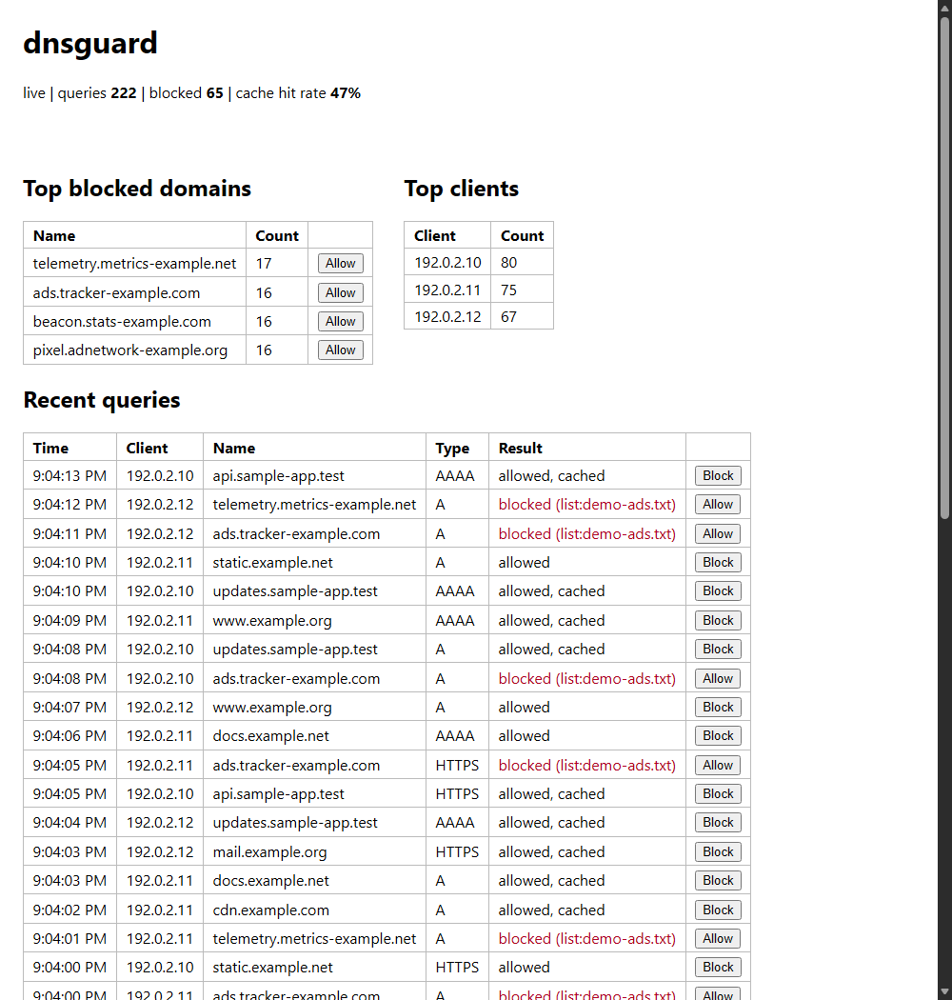

# dnsguard

A small local DNS forwarder that drops queries for domains on your blocklists. It listens on `127.0.0.1:5353`, answers blocked names itself (`0.0.0.0` / `::`, or NXDOMAIN) and forwards everything else to an upstream resolver (default `1.1.1.1`, UDP first, TCP when the answer is truncated). Queries go into a SQLite log, and `dnsguard ui` serves a plain local web page with the recent queries and top lists.

Node 22.5+ (uses `node:sqlite`), no dependencies. Tested on Node 26 / Windows.

The screenshot uses synthetic demo traffic (`dnsguard ui --demo`). The page shows totals, top blocked domains, top clients and a live table of recent queries. The button on a row writes that domain to `allow.txt` or `deny.txt` and takes effect immediately.

## Running

    node bin/dnsguard.js init            # writes dnsguard.json, allow.txt, deny.txt, lists/custom.txt
    node bin/dnsguard.js run             # DNS only
    node bin/dnsguard.js ui              # DNS + web UI on http://127.0.0.1:5380/

dnsguard never touches your system DNS settings. To try it:

    node bin/dnsguard.js query example.com --port 5353
    nslookup -port=5353 example.com 127.0.0.1      # Linux/macOS; see below for Windows

Other commands: `check <domain>` (would it be blocked, no network), `allow <domain>`, `block <domain>`, `stats`, `log --limit N`, `update`. Flags: `--config`, `--port`, `--listen` (a non-loopback address is refused unless you also pass `--allow-open`, and then warns on stderr: it would be an open resolver), `--upstream IP[:port]`, `--block-mode null|nxdomain`, `--privacy`, `--no-open`, `--browser EXE` (or the `BROWSER` env var).

## Config

`dnsguard.json`, all keys optional. Relative paths are relative to the config file.

    {
      "upstream": "1.1.1.1",
      "port": 5353,
      "blockMode": "null",
      "blocklists": ["lists/custom.txt"],
      "sources": [{ "name": "example", "url": "https://example.test/hosts.txt", "file": "lists/example.txt" }],
      "privacy": false,
      "retentionDays": 30,
      "maxLogRows": 100000
    }

Blocklists are local files in hosts format (`0.0.0.0 ads.example.com`), one domain per line, or `||domain^` lines. A listed domain blocks its subdomains too. `dnsguard update` downloads the `sources` URLs and nothing else, only when you run it (`--dry-run` shows what it would fetch); a download that parses to zero domains does not replace the existing file.

`allow.txt` accepts plain domains (with subdomains), `*.glob` patterns and `/regex/` lines. `deny.txt` is plain domains. Order of precedence: deny, then allow, then blocklists.

With `privacy` on (or `--privacy`) the client address is never stored or shown. The log is pruned by age and row count.

## Tests

    node --test "test/*.test.js"

Covers the wire parser (compression pointers, loops, truncation at every length, random and mutated packets), list parsing, rule precedence, config errors, cache, UDP-to-TCP fallback against a fake upstream, malformed packets sent at a live server, and the UI's Host/Origin checks.

## Known gaps

- Port 5353 is used by mDNS on many machines. On the test machine other processes already held UDP 5353 and binding failed with EACCES, so dnsguard says so and you pick another port with `--port`.
- Windows `nslookup` ignores `-port` (it sent nothing to the port I tried), so on Windows use `dnsguard query`. System-wide use needs `--port 53` and setting the adapter's DNS yourself.
- No DoH/DoT, no DNSSEC handling (answers are passed through as-is), no EDNS client subnet. Only A, AAAA, CNAME, NS, PTR, MX, TXT and HTTPS records are decoded; others are forwarded untouched.
- The cache keys on name and type only and is in memory.
- Blocked HTTPS/other types get an empty NOERROR answer in `null` mode.
